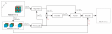
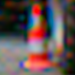
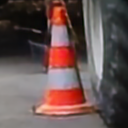
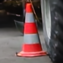
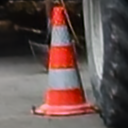
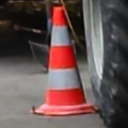
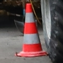
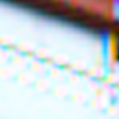
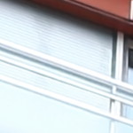
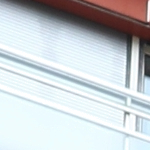

# SBFBurst: Simple Base Frame Guided Residual Network  

This repository contains the official implementation of our super-resolution work, presented at VISAPP 2024: ["Simple Base Frame Guided Residual Network for RAW Burst Image Super-Resolution"](https://www.scitepress.org/PublishedPapers/2024/123483/), as well as the corresponding journal paper: ["Enhanced residual network for burst image super-resolution using simple base frame guidance"](https://www.sciencedirect.com/science/article/pii/S0262885625000320). It also includes the SBFBurst training configurations used for the RAW-56 dataset experiments reported in our *Data in Brief* work: ["A real-world raw 56-frame burst dataset for 8× super-resolution"](https://dx.doi.org/10.2139/ssrn.7389288).
> **Abstract:** *Burst super-resolution or multi-frame super-resolution (MFSR) has gained significant attention in recent years, particularly in the context of mobile photography. With modern handheld devices consistently increasing their processing power and the ability to capture multiple images even faster, the development of robust MFSR algorithms has become increasingly feasible. Furthermore, in contrast to extensively studied single-image super-resolution (SISR), burst super-resolution mitigates the ill-posed nature of reconstructing high-resolution images from low-resolution ones by merging information from multiple shifted frames. This research introduces a novel and effective deep learning approach, SBFBurst, designed to tackle this challenging problem. Our network takes multiple noisy RAW images as input and generates a denoised, super-resolved RGB image as output. We demonstrate that significant enhancements can be achieved in this problem by incorporating base frame-guided mechanisms through operations such as feature map concatenation and skip connections. Additionally, we highlight the significance of employing mosaicked convolution to enhance alignment, thus enhancing the overall network performance in super-resolution tasks. These relatively simple improvements underscore the competitiveness of our proposed method when compared to other state-of-the-art approaches.* 
  
## Architecture and some results



A table displaying images generated by different methods on Synthetic Dataset is shown below:

|                             Base Frame                             |                             DBSR                             |                             MFIR                             |                              BIPNet                              |                           **SBFBurst**                            |                            Ground Truth                            |
|:------------------------------------------------------------------:|:------------------------------------------------------------:|:------------------------------------------------------------:|:----------------------------------------------------------------:|:-----------------------------------------------------------------:|:------------------------------------------------------------------:|
|  |  |  |  |  |  |
|  |  |  |  |  |  |

Refer to [our paper](https://www.scitepress.org/PublishedPapers/2024/123483/) for more details.

## Installation and Requirements
  
1. This project was tested in Python 3.10 and CUDA 11.8 environments. It is recommended to set up a virtual environment. All necessary requirements can be installed using pip by running the `bash install.sh` script.
    
2. The data can be downloaded from the creator repository: [Synthetic and BurstSR](https://github.com/goutamgmb/deep-burst-sr) and [RealBSR](https://github.com/yjsunnn/FBANet). Shortcuts to the datasets are given below, but it is important to check if they are still working or updated according to the original authors' pages. Download the datasets and place them in the `_DATASETS/` folder in their respective subfolders:
    
    -   **Synthetic:** [Zurich RAW to RGB Canon set](https://drive.google.com/file/d/12L0LYhG78zQBLkIDyFNE5J6fIH02NUgz/view?usp=drive_link), [Zurich RAW to RGB Canon set 2](https://drive.google.com/file/d/11Gj5mB9_A2859E_AOtkYpr2wWvhB41gF/view?usp=sharing) and [SyntheticBurst validation set](https://drive.google.com/file/d/1DHu3-_tGSc_8Wwwu6sHFaPtmd9ymd0rZ/view?usp=drive_link)
    -   **BurstSR:** [BurstSR dataset (cropped)](https://drive.google.com/drive/folders/1A8FytFrYP-y7pZZhfFxVRzEPwcKl-Cp7?usp=drive_link)
    -   **RealBSR:** [Cropped RealBSR-RGB and Cropped RealBSR-RAW](https://drive.google.com/drive/folders/1d4FOmRs0cKxWLPCsH-x7apVfsRJMKSJ4?usp=sharing)
    -   **RAW-56:** [RAW-56 Burst Super-Resolution Dataset (Hugging Face)](https://huggingface.co/datasets/andersoncotrim/raw-56-burst-super-resolution), used for the *Data in Brief* experiments.

3. Update the paths in `local.py` according to your local environment. The environment setting file [admin/local.py](admin/local.py) contains the paths for pretrained networks, datasets, etc.

  
## Pretrained Model  
  
All the checkpoints including the SpyNet and PWCNet weights are located in the `pretrained_models/` folder. 

| Model                               |     PSNR      |  SSIM  | LPIPS  |  
|:------------------------------------|:-------------:|:------:|:------:|  
| SBFBurst Synthetic                  |    42.1918    | 0.9684 | 0.0367 |  
| SBFBurst Real World BurstSR         |    48.8719    | 0.9870 | 0.0224 |
| SBFBurst Real World RealBSR RGB     |    31.0709    | 0.9036 | 0.0960 |  

  
## Evaluation  
  
The scripts `run_test_synthetic.py`, `run_test_burstsr.py`, and `run_test_realbsr.py` are configured to load models from the `pretrained_models/` folder. They will save the predictions in the `workspace/` folder. Ensure you adjust these settings according to meet your requirements.

### Synthetic testing
```python
python run_test_synthetic.py
```  
### Real World BurstSR testing
```python
python run_test_burstsr.py
```  
### RealBSR RGB testing
```python
python run_test_realbsr.py
```

### Raw56Dataset testing
```python
python run_test_exp_raw56.py
```
  
## Training  

The training configurations are located in the `train_settings/sbfburst` directory. You can run the training using the following commands:

### Synthetic training
```python
python run_training.py sbfburst default_synthetic
```  
### Real World BurstSR training
```python
python run_training.py sbfburst default_burstsr
```  
### RealBSR RGB training
```python
python run_training.py sbfburst default_realbsr
```  

### Raw56Dataset training

The RAW-56 experiments use two SBFBurstRAW training configurations: one with 14 frames and one with all 56 frames. 

**14-frame training:**

```bash
python run_training.py sbfburst raw56_14frames
```

**All frames (56-frame) training:**

```bash
python run_training.py sbfburst raw56_allframes
```  

## Related Resources

- **Dataset:** [Hugging Face](https://huggingface.co/datasets/andersoncotrim/raw-56-burst-super-resolution) ([DOI](https://doi.org/10.57967/hf/10146))
- **Capture:** [raw56-capture](https://github.com/AndersonCotrim/raw56-capture) — Android RAW burst acquisition.
- **Preprocessing:** [raw56-preprocessing](https://github.com/AndersonCotrim/raw56-preprocessing) — DNG processing and dataset generation.

## Citation

Please cite the corresponding publications when using the code or RAW-56 experiments:

- Cotrim et al. (2024). *Simple Base Frame Guided Residual Network for RAW Burst Image Super-Resolution*. VISAPP. [DOI](https://doi.org/10.5220/0012348300003660).
- Cotrim et al. (2025). *Enhanced residual network for burst image super-resolution using simple base frame guidance*. Image and Vision Computing. [DOI](https://doi.org/10.1016/j.imavis.2025.105444).
- Cotrim et al. (2026). *A real-world raw 56-frame burst dataset for 8× super-resolution*. SSRN. [DOI](https://doi.org/10.2139/ssrn.7389288).

## Acknowledgements

The training and testing codes are based on [Deep-Burst-SR](https://github.com/goutamgmb/deep-burst-sr), [BipNet](https://github.com/akshaydudhane16/BIPNet/tree/main), [FBANet](https://github.com/yjsunnn/FBANet) and [BasicVSR_PlusPlus](https://github.com/ckkelvinchan/BasicVSR_PlusPlus).

## Contact  

My email is ander.cotrim@gmail.com. Please feel free to contact me regarding anything related to the paper. I'm also glad to discuss any topic related to Super-Resolution!

## License

[CC BY-NC-SA 4.0](https://creativecommons.org/licenses/by-nc-sa/4.0/). See [LICENSE](LICENSE) for details and third-party terms.
